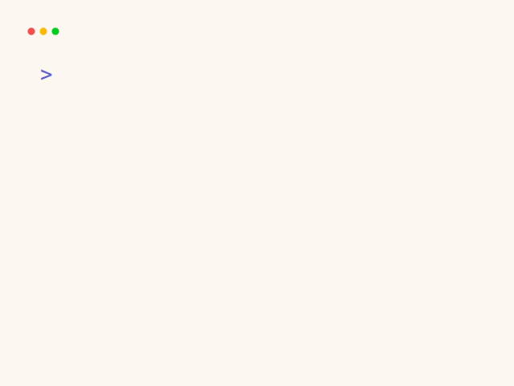
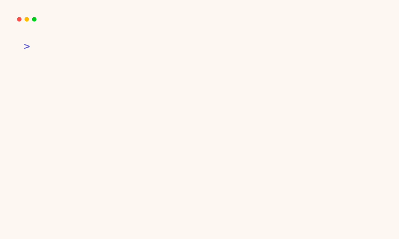
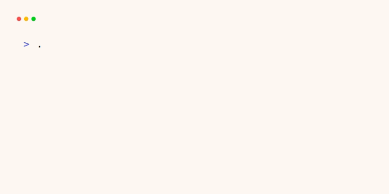
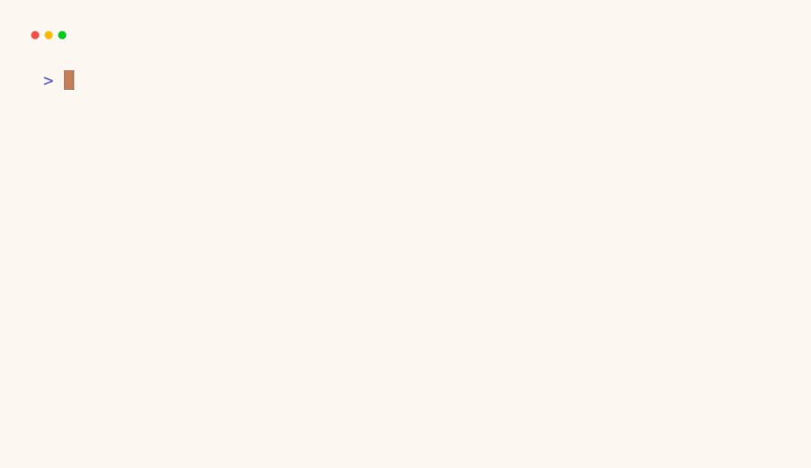
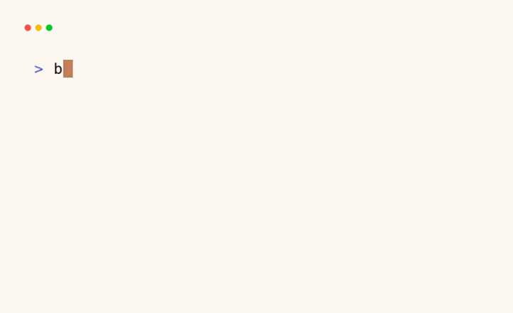
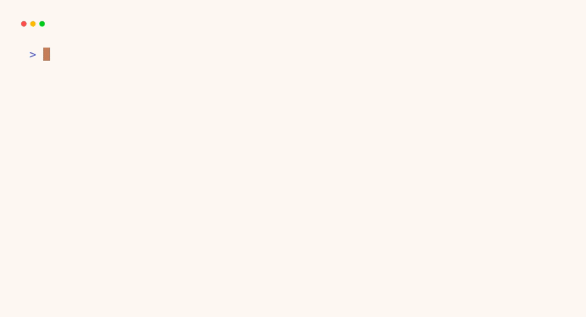
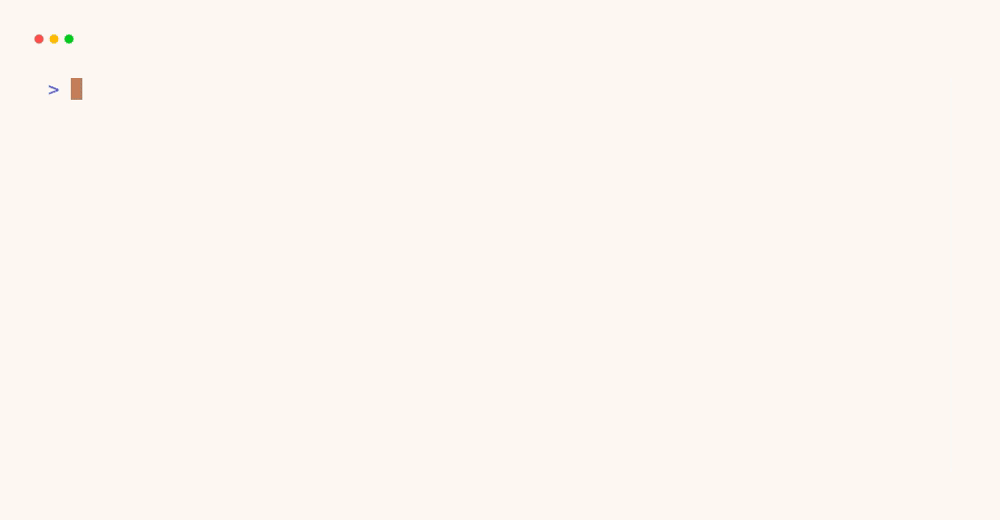

# Ferret

**Ferret — Review memory that learns.**

Ferret is a repository-specific review intelligence daemon. It learns the mapping between code changes and review outcomes from teachers — CodeRabbit, GitHub reviews, SARIF, CI fix loops, and humans — and progressively assumes more of the review workload.

<p align="center">
  
</p>

<p align="center">
  <a href=".brandi/identity.yaml">Brand genome</a> ·
  <a href="tapes/">VHS tapes</a> ·
  <a href="https://github.com/elci-group/ferret">Source</a>
</p>

---

It is **review distillation**, not a generic linter. Ferret builds a corpus from:

- Code diffs and stable hunk IDs
- Review comments, severity, and category
- Developer accept / reject / fix dispositions
- Repository context and conventions

Over time Ferret answers questions like:

- Would CodeRabbit usually complain about this?
- Is this repository strict about lifetime annotations?
- Does this team prefer `Result<T, E>` over panics?

## Confidence routing

| Confidence | Action |
|------------|--------|
| ≥ 0.98 | Ferret reviews alone |
| 0.75 – 0.98 | Ferret + optional teacher verification |
| < 0.75 | Escalate to teacher (default: CodeRabbit) |

Architecture findings escalate earlier (default threshold 0.95).

## Workspace

| Crate | Role |
|-------|------|
| `ferret-core` | Domain types, teacher trait |
| `ferret-store` | SQLite corpus persistence |
| `ferret-ingest` | Git diff extraction, hunk normalization |
| `ferret-teachers` | GitHub, SARIF, CodeRabbit adapters |
| `ferret-index` | Corpus indexing hooks |
| `ferret-infer` | Retrieval-based predictor |
| `ferret-route` | Confidence routing |
| `ferret-cli` | `ferret` command-line tool |
| `ferret-daemon` | `ferretd` webhook daemon |

## Quick start

```bash
cargo build
cargo test

# Initialize local corpus database
cargo run -p ferret-cli -- init

# Register a repository
cargo run -p ferret-cli -- register --slug elci-group/ferret

# Capture a snapshot from a unified diff
cargo run -p ferret-cli -- snapshot \
  --repo elci-group/ferret \
  --base abc123 --head def456 \
  --diff /path/to/changes.diff

# Corpus stats
cargo run -p ferret-cli -- stats

# Start daemon (health + stats endpoints)
cargo run -p ferret-daemon -- --listen 127.0.0.1:8787
```

## CLI in action

### Logo

Print the Ferret brand mark.



### Init

Initialize the local database.



### Register

Register a repository profile.



### Snapshot

Capture a review snapshot from a diff.



### Stats

Show corpus statistics.



### Predict

Predict findings for a snapshot using retrieval.



### Route

Show routing decisions for predicted findings.



## Brand

Ferret's identity is stored in `.brandi/` and linted with [brandi](https://github.com/elci-group/brandi). The palette is inspired by the animal: warm browns, cream, and a pink nose, with clear semantic colors for success, warning, and error states.

| Role | Color |
|------|-------|
| Primary | `#C47E5A` |
| Cream | `#F5E6D3` |
| Pink nose | `#FF6B8A` |
| Dark mask | `#1A1512` |
| Success | `#7EBA5A` |
| Warning | `#FFB020` |
| Error | `#E8505A` |
| Info | `#58D5FF` |

## VHS recordings

All terminal recordings live in `tapes/` and are rendered to `tapes/output/`. Re-render them with:

```bash
for tape in tapes/*.tape; do vhs "$tape"; done
```

## Remote

https://github.com/elci-group/ferret

## License

MIT
